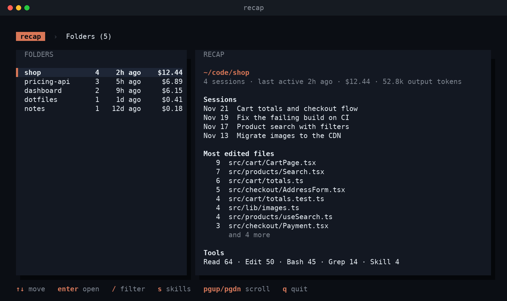
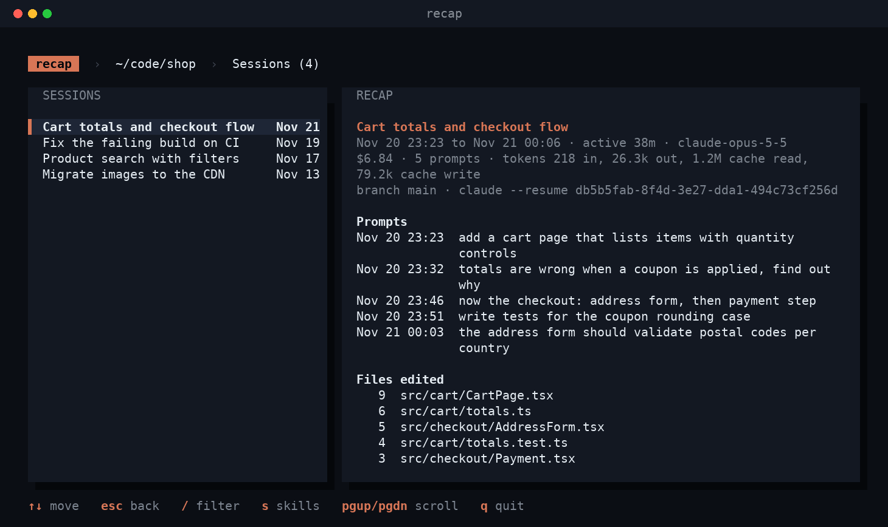
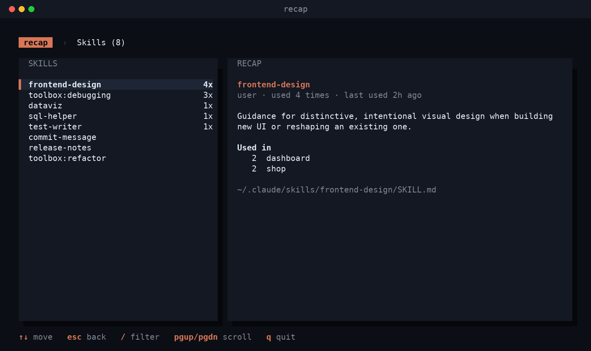
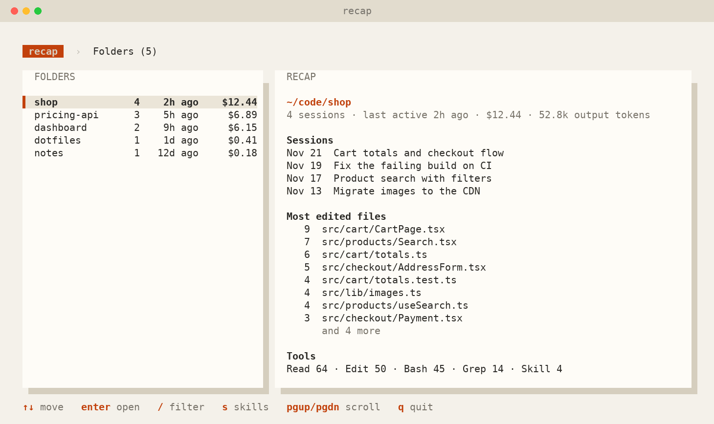

<h1 align="center">claude-recap</h1>

<p align="center">Browse your Claude Code sessions by folder and see what you did in each.</p>

<p align="center">
  <a href="https://github.com/GutoPin/claude-recap/actions/workflows/ci.yml"></a>
  <a href="LICENSE"></a>
  
</p>

<p align="center">
  
</p>

Claude Code keeps a transcript of every session, but finding "that thing I did in the shop repo last week" means scrolling through `--resume`. `claude-recap` reads those transcripts and gives you a two-pane browser: folders on the left, a recap on the right with the sessions, the prompts you typed, the files that were edited, the tools and skills that ran, and what it cost.

It is read-only and works offline. Nothing leaves your machine, and no model is called: the recap is built from what the transcripts already contain.

## Install

```sh
cargo install --git https://github.com/GutoPin/claude-recap
```

Or from a clone:

```sh
git clone https://github.com/GutoPin/claude-recap
cd claude-recap
cargo install --path .
```

Requires a recent stable Rust (it is built and tested with the current stable release).

This installs a binary called `claude-recap`. Earlier versions installed it as `recap`; installing this one with cargo removes the old binary.

## Update

```sh
claude-recap --version   # version and the commit it was built from
claude-recap update      # install the latest main branch
```

`update` runs `cargo install --git` for you, so it needs cargo on your `PATH`. It does nothing when you already have the newest commit.

## Use

```sh
claude-recap
```

| Key | Action |
| --- | --- |
| `↑` `↓` or `j` `k` | Move |
| `enter` | Open a folder; on a session, resume it in Claude Code |
| `esc` | Go back |
| `/` | Filter the current list |
| `s` | Skills: what is installed and how often you use each one |
| `pgup` `pgdn` | Scroll the recap |
| `q` | Quit |

### Sessions

Opening a folder lists its sessions, and the recap shows every prompt you typed in the selected one with its time. Filtering sessions searches their prompts too. Press `enter` on the one you want and Claude Code opens it with `claude --resume <id>`, in the folder the session ran in.

<p align="center">
  
</p>

### Skills

Press `s` from anywhere to list the skills you have installed, with how many times each one ran and in which folders.

<p align="center">
  
</p>

### Without the interface

```sh
claude-recap                    # piped: a table of folders
claude-recap folder             # recap of the current directory
claude-recap folder ~/code/shop # or of any folder, by path or by name
claude-recap skills             # installed skills and how often each was used
claude-recap --json             # everything, for your own scripts
```

`--json` works with every command.

```
FOLDER              SESSIONS  LAST ACTIVE       COST
~/code/shop                4       1h ago     $12.44
~/code/pricing-api         3       4h ago      $6.89
~/code/dashboard           2       8h ago      $6.15
~/dotfiles                 1       1d ago      $0.41
~/notes                    1      12d ago      $0.18
```

### Where it looks

`claude-recap` reads the Claude Code data directory: `--dir` if you pass it, then `$CLAUDE_CONFIG_DIR`, then `~/.claude`.

## Make it yours

`claude-recap` reads an optional JSON file at `~/.config/claude-recap/config.json` (or `$XDG_CONFIG_HOME/claude-recap/config.json`). Every key is optional; anything you leave out keeps its default.

```json
{
  "theme": { "accent": "#58a6ff", "background": "terminal" }
}
```

`claude-recap config` prints the path and every setting with its default. To try a file without installing it, pass `--config FILE` or set `$RECAP_CONFIG`.

The theme has one colour per role, each as `#rrggbb`: `background`, `surface`, `raised`, `shadow`, `text`, `muted`, `faint` and `accent`. Set `background` to `"terminal"` to keep your terminal's own background. `success`, `warning` and `danger` are accepted so one theme file works across tools, but `claude-recap` does not draw with them. A misspelled key or a bad colour is reported when the program starts.

<p align="center">
  
</p>

<details>
<summary>The theme in that screenshot</summary>

```json
{
  "theme": {
    "background": "#f4f1ea",
    "surface": "#fffdf8",
    "raised": "#ece6d8",
    "shadow": "#d6cfbf",
    "text": "#2b2a27",
    "muted": "#7a756a",
    "faint": "#c9c2b2",
    "accent": "#c2410c",
    "success": "#3f7d3a",
    "warning": "#a16207",
    "danger": "#b42318"
  }
}
```

</details>

## What the numbers mean

- Cost and active time are the figures Claude Code recorded for the session. Sessions from versions that did not record them show a dash, and no price table is guessed.
- Tokens are summed once per reply. Transcripts repeat the usage of a reply on each of its parts, so adding every record would count them several times.
- Files edited counts edit and write calls per file, not lines.
- Skills are found in your data directory, in installed plugins and in each project's `.claude/skills`. A skill that was used but is not on disk shows as "built in or removed".

## Caveats

The transcript format is internal to Claude Code and not documented. It can change with any release. `claude-recap` skips what it does not understand instead of failing, so after an update it may show less until it catches up. If a number looks wrong, please open an issue with your Claude Code version.

This project is not affiliated with Anthropic.

## Development

```sh
cargo test
cargo clippy --all-targets
cargo run -- --dir ~/.claude
```

The tests build their own made-up data directory, and the screenshots here were recorded against generated sessions. No real transcript is used or stored in this repository.

## License

MIT
